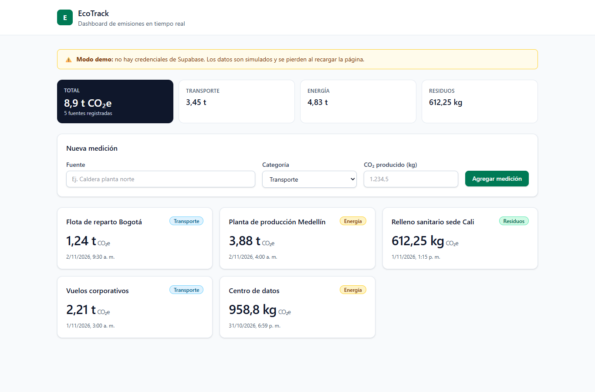
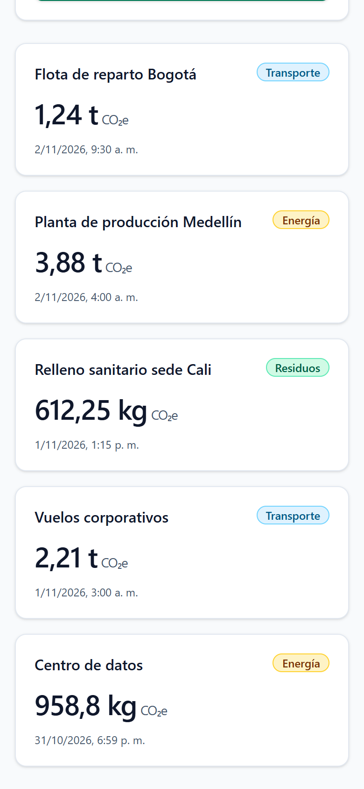
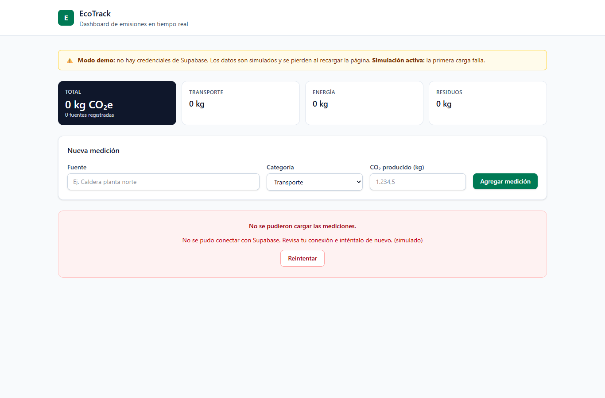
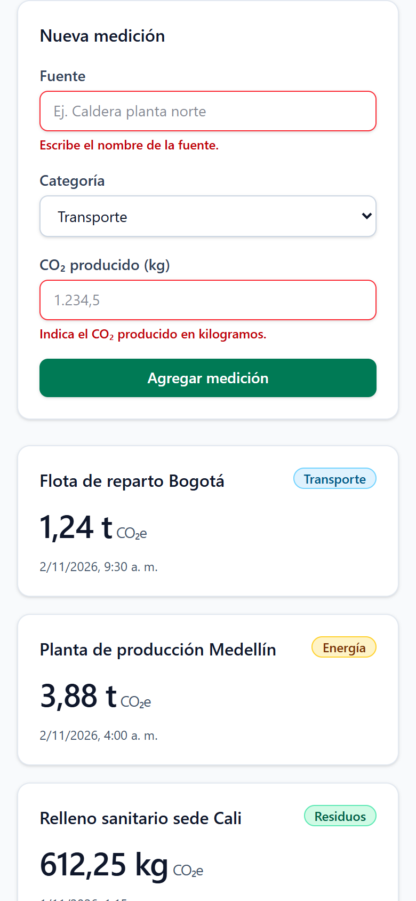

# EcoTrack · EmissionsTracker (React + Supabase)

Proyecto Integrador «El Ciclo Spec-to-Code en Acción», módulo 3, «El Núcleo UI (React + IA)».
**Entregable principal: [BITACORA.md](BITACORA.md) ([PDF](BITACORA.pdf)).**

> **Real y simulado.** El componente, el hook, las 37 pruebas, el build y las capturas se ejecutaron.
> Sin `.env`, la app arranca en **modo demo**: datos de ejemplo en memoria, marcados en pantalla.
> El cliente de Supabase está escrito y compilado, pero **no se ha ejecutado contra un proyecto real**,
> porque no hay credenciales. `supabase/schema.sql` se probó en PostgreSQL 17 (Docker) con un stub de Supabase: 9 de 9.

## Entregable de la rúbrica → archivo

| Entregable | Archivo |
|---|---|
| Bitácora de 3 o 4 prompts y la evolución del código | [BITACORA.md](BITACORA.md), [BITACORA.pdf](BITACORA.pdf) y los prompts sueltos en [bitacora/](bitacora/) |
| Componente `EmissionsTracker.tsx` | [src/components/EmissionsTracker.tsx](src/components/EmissionsTracker.tsx) |
| Hook `useEmissions.ts` | [src/hooks/useEmissions.ts](src/hooks/useEmissions.ts) y sus pruebas en [useEmissions.test.ts](src/hooks/useEmissions.test.ts) |
| Configuración de Supabase | [src/lib/supabaseClient.ts](src/lib/supabaseClient.ts), [src/services/emissionsService.ts](src/services/emissionsService.ts), [.env.example](.env.example) y [supabase/schema.sql](supabase/schema.sql) |
| Capturas | [docs/capturas/](docs/capturas/), con la lista en [BITACORA.md §7](BITACORA.md#7-capturas) |

## Criterio de la rúbrica → dónde se demuestra

| Criterio | Evidencia |
|---|---|
| Alineación estratégica (prompteo iterativo) | [BITACORA.md](BITACORA.md): tabla de la evolución y §1 a §4. Cada prompt cita la salida real de la versión anterior, guardada en `bitacora/vN/verificacion.txt` |
| Ejecución técnica (React + Supabase, TS, hooks) | Capas `components → hooks → services → lib` que oxlint hace cumplir ([.oxlintrc.json](.oxlintrc.json)); TS con `noUncheckedIndexedAccess` y `exactOptionalPropertyTypes`; [verificación final](docs/evidencia/verificacion-final.txt) |
| Calidad de UI y usabilidad | Tailwind responsive a 1, 2 y 3 columnas; esqueleto de carga, «Guardando…», error con «Reintentar», estado vacío y validación por campo ([capturas](docs/capturas/)) |
| Auditoría IA (código, prompts, bundle, RLS) | [BITACORA.md §6](BITACORA.md#6-auditoría-ia) |

## Vista rápida (capturas reales)

| Escritorio | Móvil |
|---|---|
|  |  |
|  |  |

Todas las capturas (carga, guardando, error al guardar, vacío...) están en [docs/capturas/](docs/capturas/).

## Árbol

```
src/
├── App.tsx                         ← encabezado y <main>
├── components/                     ← UI: solo importa hooks/, types/ y utils/
│   ├── EmissionsTracker.tsx        ← contenedor: resumen, formulario, estados y grid
│   ├── EmissionCard.tsx            ← tarjeta (memo)
│   ├── EmissionForm.tsx            ← formulario accesible con validación por campo
│   ├── EmissionsStatus.tsx         ← esqueleto, error con reintento y vacío
│   └── EmissionsSummary.tsx        ← total y desglose por categoría (memo)
├── hooks/useEmissions.ts           ← carga, inserción, errores, doble envío y modo
├── services/
│   ├── emissionsService.ts         ← Supabase: columnas, validación de filas y mensajes de error
│   ├── demoRepository.ts           ← MODO DEMO en memoria y ?simular=
│   └── index.ts                    ← elige Supabase o demo según las variables
├── lib/supabaseClient.ts           ← único createClient; null sin credenciales
├── types/emissions.ts              ← tipos de dominio y contratos
└── utils/                          ← formato, resumen y validación (funciones puras)
supabase/schema.sql                 ← tabla, checks, privilegios por columna y RLS
supabase/pruebas/                   ← stub de Supabase y 9 pruebas de RLS
bitacora/                           ← prompts 01 a 04 y las versiones v1 a v4 tal cual, con su verificación
herramientas/                       ← verificar-version.sh, verificacion-final.sh y probar-rls.sh
docs/capturas/, docs/evidencia/     ← capturas y salidas reales de las herramientas
```

## Cómo ejecutarlo

```bash
pnpm install
pnpm dev                 # modo demo; prueba también ?simular=lento|error-carga|error-guardado|vacio
pnpm typecheck           # tsc -b (ojo: `tsc --noEmit` solo no revisa nada aquí, ver BITACORA §6.1)
pnpm lint
pnpm test
pnpm build
bash herramientas/probar-rls.sh          # requiere Docker
```

Para usar Supabase de verdad:
1. Copia `.env.example` a `.env` y llena `VITE_SUPABASE_URL` y `VITE_SUPABASE_ANON_KEY`. Solo la anon
   key; la service_role nunca va en el frontend.
2. Ejecuta `supabase/schema.sql` en el SQL Editor del proyecto.
